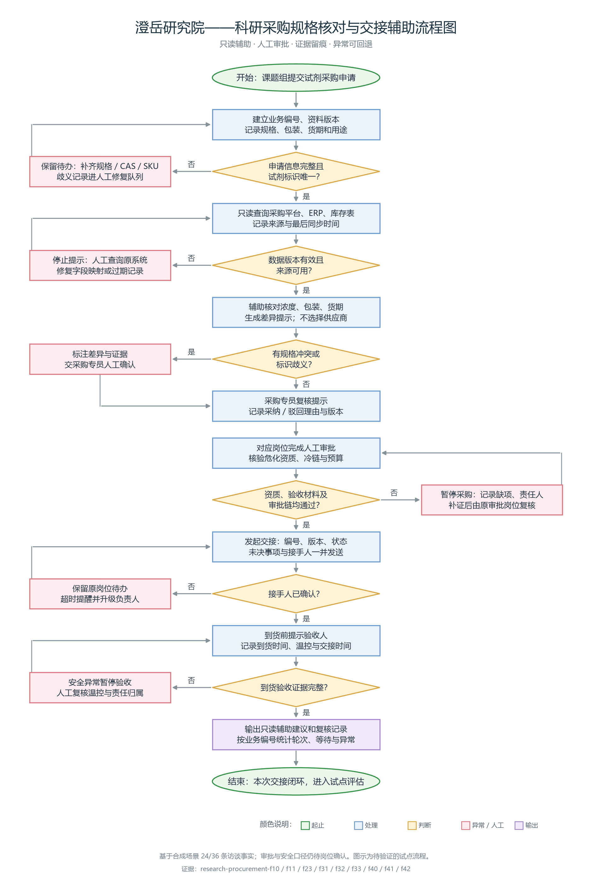

# 科研采购审核与交接助手

本项目针对**模拟案例**中的科研试剂采购，提供确定性规格检查和可追溯交接。现有 CLI 以本地 JSON 为输入；第一阶段新增 FastAPI、数据库、基于制度文本的演示检索、人工复核和交接记录。

项目只提供审核辅助。规则通过不等于采购批准；系统不会选择供应商、替代安全审批、付款或写入外部采购系统。所有示例均为虚构数据，当前服务还不是生产系统。

请从 [第一阶段 API 启动与操作指南](docs/pilot-api.md) 开始。独立的命令行混合检索问答实验见 [RAG 原型指南](docs/rag-prototype.md)。设计依据及未确认事项见 [项目设计](docs/design.md)，原 CLI 格式见 [CLI 接口](docs/api.md)。

## 现有 CLI

```powershell
$env:PYTHONPATH = 'src'
python -m my_tool.main review --input data/sample_requests.json --as-of 2026-10-23
python -m unittest discover -s tests -v
```

模拟案例提出了 20 种试剂、6 周试点，以及采购时长和紧急采购占比的改进目标；这些是待验证的设想，并非已实现的结果。详见设计文档。



许可证：[MIT](LICENSE)。

## 本机一键演示

在项目根目录安装依赖后运行 `python scripts/start_demo.py`，打开 `http://127.0.0.1:8765/chat-ui`。在页面中输入 `.local_demo/access-token.txt` 文件中的演示令牌。此启动方式使用独立的模拟数据库和本地摘录，不调用外部大模型；关闭运行脚本的终端即可停止服务。演示数据库与令牌不会提交到 Git。
