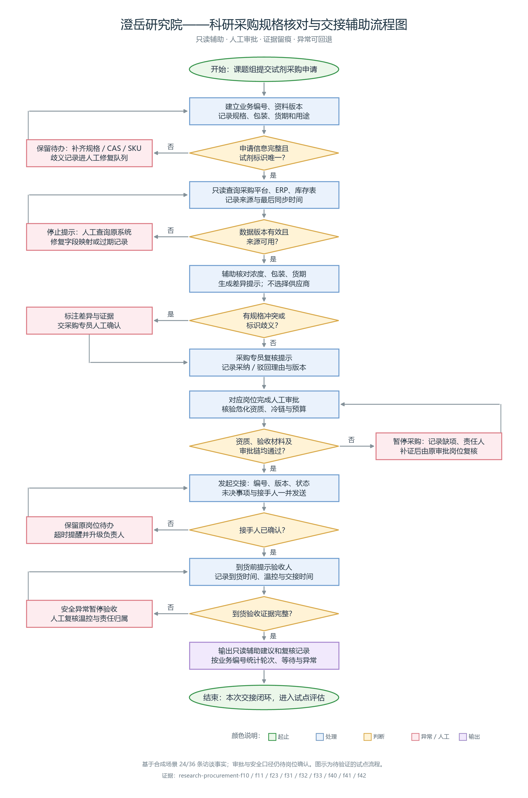

# Research Procurement Review

A read-only, rule-based prototype for a **synthetic** research procurement case. It checks reagent concentration, package size, source freshness, cold-chain evidence, approvals, and handoff confirmation. Every result remains subject to human review. The discovery findings and evidence IDs are in [docs/design.md](docs/design.md).

## Why this project exists

The discovery lab recorded 24 of 36 available facts across six roles on 2026-10-23. The strongest first pilot is specification review plus traceable handoff. The current process handles about 160 requests/month, with an average of four confirmation rounds of 20 minutes each. The management goal is to move average procurement duration from 18 to 10 days and urgent purchases from 27% to below 12%; those are **goals, not demonstrated outcomes**. The proposed pilot covers 20 common reagents for six weeks, with at least 98% specification review accuracy and a lower urgent-purchase share. The remaining facts and real-world source material still need validation.



The editable source is [scripts/render_flowchart.py](scripts/render_flowchart.py), which generates both [PNG](docs/flowchart.png) and [SVG](docs/flowchart.svg).

## Install

Python 3.11+ is recommended.

```bash
python -m venv .venv
python -m pip install -r requirements.txt
```

Activate the environment using your shell's usual command. For local source imports, set `PYTHONPATH=src` on macOS/Linux or `$env:PYTHONPATH="src"` in PowerShell.

## Run

From the repository root:

```bash
PYTHONPATH=src python -m my_tool.main review --input data/sample_requests.json --as-of 2026-10-23
PYTHONPATH=src python -m my_tool.main review --input data/sample_requests.json --as-of 2026-10-23 --output review.json
PYTHONPATH=src python -m unittest discover -s tests -v
```

PowerShell:

```powershell
$env:PYTHONPATH = "src"
python -m my_tool.main review --input data/sample_requests.json --as-of 2026-10-23
python -m unittest discover -s tests -v
```

The sample is fabricated. The tool never writes to procurement systems, selects a supplier, approves hazardous materials, or makes a payment. A `ready_for_human_review` result means its local checks passed; it is **not** purchase approval.

## Project layout

`src/my_tool/` contains the CLI, core checks, and file utilities. `docs/` describes the research and JSON interface. `tests/`, `examples/`, `scripts/`, `config/`, `data/`, and `.github/` follow the requested GitHub project framework.

## Pilot decision

Start with a read-only 20-reagent sample and double-check each suggestion with procurement staff. Record business ID, data version, receiver confirmation, missing evidence, and review result. Before deployment, confirm the reagent list, field mapping, reviewer names, approval matrix, anomaly frequency, baseline measurement window, data retention, and system access. See [docs/design.md](docs/design.md).

## License

MIT. See [LICENSE](LICENSE).
